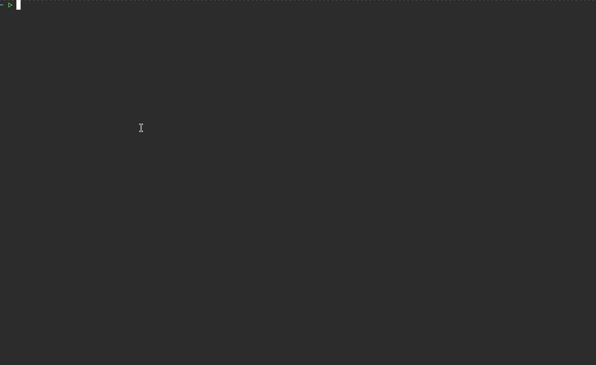

<p align="center">
    <b>adshell-rs</b>
</p>

<p align="center">
    
    
    
    
</p>

<hr />

**adshell-rs** for **Active Directory Shell** is a cross-platform, pure-Rust interactive LDAP shell and Active Directory attack toolkit. It runs each action over **either LDAP(S) or ADWS (SOAP)**, selected at runtime with `--transport ldap|soap`: the same technique, the same result, only a different wire. ADWS (the SOAP/WS-* endpoint on TCP `9389`, which the DC proxies to its local LDAP) is often reachable when LDAP is filtered or closely monitored, and the traffic reads as legitimate admin tooling.

It is built on the transport model of [RustHound-CE](https://github.com/g0h4n/RustHound-CE) (same `ldap3` + `rustls` stack, the same `--transport ldap|(adws,soap)` switch) and performs its ADWS reads and writes through [`adws`](https://github.com/g0h4n/adws). Authentication mirrors RustHound-CE and [PassTheCert-rs](https://github.com/g0h4n/PassTheCert-rs): password, pass-the-hash (NTLM), Kerberos and Pass-the-Certificate over LDAP; password and pass-the-hash over ADWS.

- [HELP.md](HELP.md) - How to compile it? How to use it? All actions with examples.
- [CHANGELOG.md](CHANGELOG.md) - A record of all significant version changes
- [ROADMAP.md](ROADMAP.md) - Transports, implemented actions and planned evolutions.

# Quick usage

## Compilation

```bash
# Build a release binary
cargo build --release
# Binary: ./target/release/adshell-rs
```

## Usage

```bash
# Confirm the identity (LDAP, simple bind)
adshell-rs -d essos.local -u daenerys.targaryen -p 'BurnThemAll!' --action whoami
# Confirm the identity (SOAP)
adshell-rs -d essos.local -u daenerys.targaryen -p 'BurnThemAll!' --transport adws --action whoami

# Same, over ADWS (SOAP) instead of LDAP
adshell-rs -d essos.local -u daenerys.targaryen -p 'BurnThemAll!' -t soap --action read_rbcd --delegate-to BRAAVOS$

# Pass-the-hash, write RBCD over ADWS
adshell-rs -d essos.local -u daenerys.targaryen -H 34534854d33b398b66684072224bb47a -t soap --action write_rbcd --delegate-to MEEREEN$ --delegate-from attacker$
```

The transport is `ldap` by default; `-t soap` (alias `-t adws`, case-insensitive) runs the same action over ADWS. More examples and the full list of actions are on the [help page](HELP.md).

# Demo



# Actions

`--action` defaults to `ldapshell`, the interactive shell, which drives whichever transport authenticated (each command runs over LDAP or ADWS).

| Action | LDAP | ADWS | Description |
|---|:---:|:---:|---|
| `ldapshell` (default) | :white_check_mark: | :white_check_mark: | Interactive shell exposing every action (Tab completion, history). |
| `whoami` | :white_check_mark: | :white_check_mark: | Confirm the authenticated identity. |
| `read_rbcd` / `write_rbcd` / `remove_rbcd` / `flush_rbcd` | :white_check_mark: | :white_check_mark: | Resource-Based Constrained Delegation (`msDS-AllowedToActOnBehalfOfOtherIdentity`). |
| `del_computer` | :white_check_mark: | :white_check_mark: | Delete a machine account. |
| `add_computer` | :white_check_mark: | :white_check_mark: | Create a machine account (ADWS needs `Create`). |
| `modify_user` (`--elevate`) | :white_check_mark: | :white_check_mark: | Reset a user's password, or grant DCSync. |
| `add_member` / `remove_member` | :white_check_mark: | :white_check_mark: | Group membership. |
| `enable_account` / `disable_account` | :white_check_mark: | :white_check_mark: | Toggle the ACCOUNTDISABLE UAC flag. |
| `read_object` | :white_check_mark: | :white_check_mark: | Dump every attribute of an object. |
| `add/list/remove/flush_shadow_cred` | :white_check_mark: | :white_check_mark: | Shadow Credentials via `msDS-KeyCredentialLink`. |

See [ROADMAP.md](ROADMAP.md) for the full plan and [HELP.md](HELP.md) for examples.

# Disclaimer

This is offensive security tooling. Use it only against systems you are explicitly authorized to test.